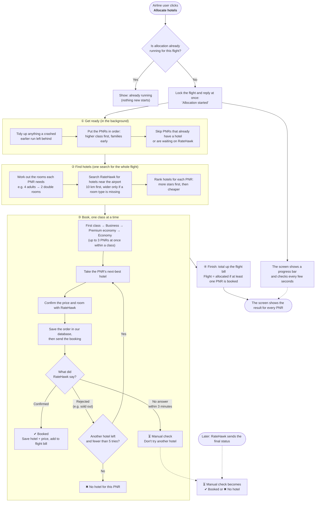
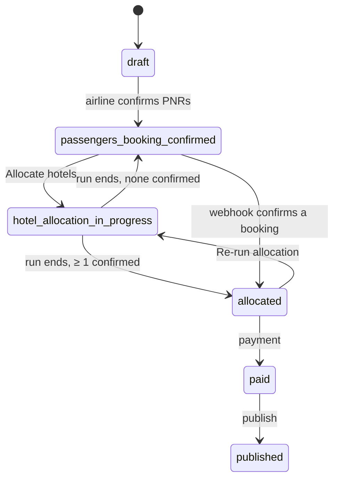

# Hotel allocation pipeline

What happens, step by step, after an airline user clicks **Allocate hotels**: how FlyVoid finds hotels, books one per PNR with RateHawk, what it writes to the database at each step, and what the API serves back. Every step is followed through one example flight with 5 PNRs.

As of 12 Oct 2026 · Code: `backend/src/cancelled-flights` · Supplier: RateHawk (ETG API v3)

## Contents

- [Overview](#overview)
- [The example flight](#the-example-flight)
- [1. The click](#1-the-click)
- [2. Prepare the run](#2-prepare-the-run)
- [3. Plan: search and candidate hotels](#3-plan-search-and-candidate-hotels)
- [4. Book, class by class](#4-book-class-by-class)
- [5. One booking attempt, in detail](#5-one-booking-attempt-in-detail)
- [6. What happens to each example PNR](#6-what-happens-to-each-example-pnr)
- [7. Finish the run](#7-finish-the-run)
- [8. Late results: the RateHawk webhook](#8-late-results-the-ratehawk-webhook)
- [9. What we serve to the screen](#9-what-we-serve-to-the-screen)
- [10. Database reference](#10-database-reference)
- [11. Status reference](#11-status-reference)
- [12. Safety rules and re-runs](#12-safety-rules-and-re-runs)
- [13. Settings](#13-settings)
- [14. Known gaps](#14-known-gaps)
- [Appendix A. IDs in a booking](#appendix-a-ids-in-a-booking)
- [Appendix B. RateHawk calls, in order](#appendix-b-ratehawk-calls-in-order)
- [Appendix C. Errors and retries](#appendix-c-errors-and-retries)
- [Appendix D. The airline screens](#appendix-d-the-airline-screens)
- [Appendix E. Single-PNR endpoints](#appendix-e-single-pnr-endpoints)

## Overview

Allocation books **one hotel per PNR** for the night of the cancellation, near the departure airport. It runs in the background: the click returns immediately and the screen polls for progress. Higher cabin classes book first, every booking is recorded before it is sent to RateHawk, and a booking whose result is unknown is never booked twice.



## The example flight

Flight **#120**, departing **CDG** (Paris Charles de Gaulle), was cancelled on **12 Nov 2026**. The stay is always one night: check-in on the cancellation date, check-out the next day (`2026-11-12` → `2026-11-13`). The airline's platform fee is **10%**. Hotels, IDs and prices below are illustrative; the logic is exactly what the code does.

| PNR | Lead guest | Class | Adults | Children | Notes |
|---|---|---|---:|---:|---|
| `AB12CD` | Anna Martin | Business | 2 | 0 | |
| `EF34GH` | Ben Okafor | Business | 2 | 1 | Travelling with a child |
| `IJ56KL` | Chen Wei | Economy | 4 | 0 | Group of 4 |
| `MN78OP` | Dana Silva | Economy | 1 | 0 | |
| `QR90ST` | Eli Novak | Premium economy | 3 | 0 | |

Before allocation the airline has added these PNRs (manually or by CSV) and confirmed them, so the flight is in status `passengers_booking_confirmed`.

## 1. The click

The wizard calls `POST /api/v1/cancelled-flights/120/hotel-allocations`. The request finishes in well under a second; booking happens afterwards in the background.

1. **Checks.** The user must belong to the flight's airline and have edit access. The flight must be in `passengers_booking_confirmed` or `allocated` (re-runs are allowed), have a cancellation date and a departure airport, and have at least one PNR. Otherwise: 400 or 404.
2. **Claim the run lock.** In one transaction the flight row is locked (`SELECT … FOR UPDATE`). If it is already `hotel_allocation_in_progress` and was touched in the last 5 minutes, another run is alive: **409 Conflict**. Otherwise the flight is set to `hotel_allocation_in_progress`, given a new `hotel_allocation_run_id` (UUID) and its `hotel_allocation_error` is cleared.
3. **Respond.** **202 Accepted** with the current allocation summary (all PNRs `NOT_STARTED` on a first run). The wizard starts polling.

> **Database after the click** · `cancelled_flights` #120: `status = hotel_allocation_in_progress`, `hotel_allocation_run_id = 'run-7f3a…'`, `hotel_allocation_error = NULL`.

## 2. Prepare the run

The background run starts a **heartbeat**: every 60 seconds (and after each PNR) it touches the flight row, so other requests can tell the run is alive. If the server dies, the heartbeat stops and after 5 minutes the run counts as stale, so allocation can be started again.

1. **Recover interrupted attempts.** Attempts from a previous run that crashed are closed: never sent to RateHawk → `failed` (`interrupted_before_request`, not counted against the PNR); already sent → `manual_check` (`interrupted_after_request`), because the hotel may be booked.
2. **Fetch missing order info.** Confirmed bookings older than 90 s that never got their RateHawk order details (`hotel/order/info`) get them now.
3. **Fix the processing order.** PNRs are sorted once and the order is saved, so every re-run processes them the same way. Sort: cabin class (first → business → premium economy → economy), then PNRs with special notes, then PNRs with children, then PNR code.

**Processing order for the example**

| processing_order | PNR | Class | class_priority | Why here |
|---:|---|---|---:|---|
| 1 | `EF34GH` | Business | 2 | Business, has a child |
| 2 | `AB12CD` | Business | 2 | Business |
| 3 | `QR90ST` | Premium economy | 1 | Premium economy |
| 4 | `IJ56KL` | Economy | 0 | Economy, PNR code sorts first |
| 5 | `MN78OP` | Economy | 0 | Economy |

> **Database** · `hotel_allocations`: one row per PNR is created (status `draft`, empty hotel fields, check-in/out dates, platform fee %, `processing_order`, `class_priority`). Existing rows only get the order filled if missing. This table always holds the **current** hotel for each PNR.

## 3. Plan: search and candidate hotels

Only PNRs still needing a hotel are processed (row status `draft`, `failed` or `cancelled`). Confirmed and MANUAL_CHECK PNRs are skipped. A PNR whose plan is less than 60 minutes old reuses it, so a quick re-run does not search again; PNRs that failed are always planned again.

### 3a. Room split per PNR

Each party size maps to a fixed room rule (no child is ever alone in a room). Each rule has a **preferred** split and a **fallback**. Parties without a rule (e.g. 10 adults) or with bad data are marked `failed` straight away with "Invalid passenger data".

| PNR | Party | Preferred split | Fallback split | Chosen |
|---|---|---|---|---|
| `EF34GH` | 2A + 1C | 1 room (2A+1C) | (1A+1C) + (1A) | Preferred |
| `AB12CD` | 2A | 1 room (2A) | none | Preferred |
| `QR90ST` | 3A | 1 room (3A) | (2A) + (1A) | Preferred |
| `IJ56KL` | 4A | 2 rooms (2A + 2A) | (3A) + (1A) | Preferred |
| `MN78OP` | 1A | 1 room (1A) | none | Preferred |

The **chosen** split is picked after the search: a split that one hotel can cover completely wins, then the cheapest estimate, then fewer room types, then fewer rooms.

### 3b. One RateHawk search for the whole flight

All room shapes needed by any split are searched once (deduplicated). Here that is 5 shapes: `1A`, `2A`, `3A`, `2A+1C`, `1A+1C`.

1. **Find hotels near the airport.** `search/serp/geo` around CDG's coordinates, radius 10 km, up to 100 hotels, for the first shape. (This endpoint allows only 10 calls a minute, so we make one per round.)
2. **Learn star ratings.** Search results carry no stars, so `search/serp/hotels` is called once per star value (1–5) with a star filter over those hotel IDs. Hotels matching none are unrated (0).
3. **Price the other shapes.** `search/serp/hotels` for each remaining shape over the same hotel IDs (100 IDs per call, 3 calls at a time).
4. **Widen if needed.** Shapes with no hotel at all are searched again at 20 km, 30 km … up to 50 km. Only the missing shapes are re-searched.
5. **Normalise.** Each rate becomes a **rate key** (hotel ID, dates, guests, room name, meal, room group; no RateHawk hash), with its show price (what we charge from), charge price (what we pay), currency, rooms left (`allotment`), meal and cancellation rules. Only deposit-payable rates are kept.

Example search result (3 hotels):

| Hotel (hid) | Stars | 2A | 2A+1C | 3A | 1A | 1A+1C |
|---|---|---|---|---|---|---|
| Aérogare Grand (8101) | 5★ | €210 · 2 left | €260 · 1 left | €245 · 1 left | – | – |
| Roissy Park Hotel (8102) | 4★ | €150 · 3 left | €175 · 1 left | €190 · 1 left | €120 · 2 left | – |
| Terminal Inn (8103) | 3★ | €95 · 4 left | – | €130 · 2 left | €80 · 3 left | €90 · 2 left |

### 3c. Supply pool (150% buffer)

For each room shape we add up how many rooms the flight needs, then reserve a **pool** of the best rates covering **1.5×** that number (rounded up). Best means: exact fit first, then more stars, then less oversized, then cheaper. Pool rates are tried first; the rest are overflow. The buffer leaves room for rates that turn out sold out at booking time.

| Shape | Rooms needed | Pool target | Pool (in order) |
|---|---:|---:|---|
| 2A | 3 (AB12CD 1 + IJ56KL 2) | 5 | Aérogare Grand (2) + Roissy Park (3) |
| 2A+1C | 1 | 2 | Aérogare Grand (1) + Roissy Park (1) |
| 3A | 1 | 2 | Aérogare Grand (1) + Roissy Park (1) |
| 1A | 1 | 2 | Roissy Park (2) |

### 3d. Candidate hotels per PNR

For each PNR, every hotel that can fit **all of its rooms** becomes a candidate. All rooms of a PNR are always in the same hotel. A candidate is **pool** if all its rates are in the pool, otherwise **overflow**. Order: pool first, then more stars, then cheaper. Inside each candidate, each room keeps an ordered list of rate options (pool rates and exact fits first), so the booker can fall back to another rate at the same hotel.

| PNR | Candidate 1 | Candidate 2 | Candidate 3 |
|---|---|---|---|
| `EF34GH` | Aérogare Grand · pool · €260 | Roissy Park · pool · €175 | – |
| `AB12CD` | Aérogare Grand · pool · €210 | Roissy Park · pool · €150 | Terminal Inn · overflow · €95 |
| `QR90ST` | Aérogare Grand · pool · €245 | Roissy Park · pool · €190 | Terminal Inn · overflow · €130 |
| `IJ56KL` | Aérogare Grand · pool · €420 | Roissy Park · pool · €300 | Terminal Inn · overflow · €190 |
| `MN78OP` | Roissy Park · pool · €120 | Aérogare Grand · overflow · €210 (2A room) | Terminal Inn · overflow · €80 |

> **Database** · One `plan_id` (UUID) for this planning round. `hotel_booking_candidates`: one row per PNR × hotel (13 rows here) with `candidate_order`, stars, tier, estimated price and the room/rate options as JSON. `hotel_allocations`: each planned PNR gets `plan_id`, `planned_at = now()` and `room_plan` (e.g. `[{"adults":2,"children":0,"roomsNeeded":2}]` for IJ56KL), and its hotel fields are cleared.

## 4. Book, class by class

PNRs are booked in **stages by cabin class**, highest first. A stage finishes completely before the next starts, so business passengers get first pick of rooms. Inside a stage, up to **3 PNRs** are booked at the same time, in processing order.

| Stage | PNRs (in parallel) |
|---|---|
| Business (rank 2) | `EF34GH`, `AB12CD` |
| Premium economy (rank 1) | `QR90ST` |
| Economy (rank 0) | `IJ56KL`, `MN78OP` |

### How one PNR picks its hotel

An in-memory **room ledger** tracks how many rooms of each rate are still free in this run. It starts from the search's `allotment`, minus rooms already used by earlier attempts in the same plan. For each PNR:

1. **Take the next candidate.** For each room, take the first rate option that has enough rooms left in the ledger and has not already failed for this PNR.
2. **Hold the rooms.** The ledger holds those rooms, so a PNR booking in parallel can't take the same last room.
3. **Attempt the booking.** See [section 5](#5-one-booking-attempt-in-detail).
4. **Act on the result.**
   - **confirmed** → keep the held rooms, done.
   - **unknown** → keep the held rooms (they may be booked), stop: no other hotel is tried.
   - **rejected** → release the rooms, never use those rates again for this PNR, try the next candidate.
   - **blocked** (another attempt is already open) → stop.
5. **Give up.** After **5** definite failures, or when no candidate has rooms left, the PNR is marked `failed` with the last reason.

## 5. One booking attempt, in detail

An **attempt** is one try at booking one PNR into one hotel (all its rooms). Each attempt is a row in `hotel_booking_attempts`; the PNR's row in `hotel_allocations` always mirrors its most important attempt.

1. **Open the attempt (database first).** In a transaction that locks the PNR: refuse if the PNR already has an open (pending, success or manual_check) attempt or a confirmed hotel; this is backed by a unique index, so two processes can never book the same PNR at once. Insert the attempt as `pending` with its rate keys, hotel and `attempt_order`. The PNR row shows `in_progress`: "Booking in progress at Aérogare Grand".
2. **Re-check each room's rate.** RateHawk `search/hp` (hotel page) for the hotel, pick the same room group + meal (or same room name + meal, or the cheapest deposit rate), then `hotel/prebook`. This returns the final price, a prebooked key for booking, and any **taxes payable at the hotel**. If the room holds fewer guests than needed → `rate_mismatch`; if a rate is gone → `rate_check_failed`. Both are definite failures.
3. **Mark "request sent".** A compare-and-set sets `provider_request_sent_at`. From here on, a crash means "may be booked", never "not booked".
4. **Book each room as its own RateHawk order.**
   - `hotel/order/booking/form` with a new `partner_order_id` (UUID; retried with a new ID on timeouts). Payment must be **deposit** (no card).
   - **The order is saved to `provider_orders` before anything is sent** (room no., reference, rate key, full rate snapshot, status `pending`).
   - `hotel/order/booking/finish` with the lead guest name (letters only), extra guests as "Guest", the **FlyVoid email** and the **PNR's phone** (airline phone if missing), and a comment "PNR … / booking …".
   - Poll `booking/finish/status` every 2.5 s for up to 180 s.
5. **Confirmed.** Load the hotel profile once per run (RateHawk Content API: name, stars, address, phone, email, images, amenities, policies). Build the PNR's hotel row with prices, then in one transaction set the attempt to `success` and the PNR row to `confirmed` with all hotel data. Refresh the flight totals. After 90 s, fetch `hotel/order/info` and store it on the attempt.
6. **Not confirmed.** A definite RateHawk error before any room was booked → `failed` (`supplier_rejected`). Still processing after 180 s, a timeout after finish, or some rooms booked → `manual_check`. The webhook resolves these later.

> **Which ID is which?** Each room order has our own `partner_order_id` (a UUID we generate) and RateHawk's `order_id` (their number). Both are explained in [Appendix A](#appendix-a-ids-in-a-booking).

### Pricing (per PNR)

RateHawk gives two amounts per rate: the **show net** (our price basis) and the **charge net** (what our deposit pays). Taxes payable at the hotel are not included; the guest pays them at check-in and they are shown on the voucher.

```text
actual_price   = sum of room show nets
buying_price   = sum of room charge nets        (our cost)
selling_price  = actual_price                    (no commission today)
platform_fee   = (selling_price + tax) × fee %   (tax = 0 today)
total_price    = selling_price + tax + platform_fee   ← billed to the airline
earnings       = total_price − buying_price
```

Example, `AB12CD` at Aérogare Grand: show €210, charge €200 → fee €21.00, total **€231.00**, earnings €31.00.

## 6. What happens to each example PNR

| Stage | PNR | Attempts | Result |
|---|---|---|---|
| Business | `EF34GH` | #101 Aérogare Grand, 1 room 2A+1C → confirmed | SUCCESS |
| Business | `AB12CD` | #102 Aérogare Grand, 1 room 2A → confirmed (ledger: 1 of 2 Aérogare 2A rooms left) | SUCCESS |
| Premium eco. | `QR90ST` | #103 Aérogare Grand 3A → prebook says sold out → failed `rate_check_failed`; #104 Roissy Park 3A → confirmed | SUCCESS |
| Economy | `IJ56KL` | Aérogare has only 1 free 2A room, so it is skipped without an attempt. #105 Roissy Park, 2 rooms 2A → two RateHawk orders, both confirmed | SUCCESS |
| Economy | `MN78OP` | #106 Roissy Park 1A → finish sent, still `processing` after 180 s → manual_check `outcome_unknown` | MANUAL_CHECK → SUCCESS when the webhook arrives |

**Rows written for these attempts**

| attempt id | PNR | attempt_order | status | failure_code | provider_orders |
|---|---|---:|---|---|---|
| 101 | EF34GH | 1 | success | | 1 order, booked |
| 102 | AB12CD | 1 | success | | 1 order, booked |
| 103 | QR90ST | 1 | failed | rate_check_failed | none (failed before booking) |
| 104 | QR90ST | 2 | success | | 1 order, booked |
| 105 | IJ56KL | 1 | success | | 2 orders, both booked |
| 106 | MN78OP | 1 | manual_check | outcome_unknown | 1 order, pending |

**Billing per PNR (10% platform fee)**

| PNR | Hotel | Rooms | Actual (show) | Buying (charge) | Platform fee | Total billed | Earnings |
|---|---|---:|---:|---:|---:|---:|---:|
| EF34GH | Aérogare Grand | 1 | 260.00 | 248.00 | 26.00 | 286.00 | 38.00 |
| AB12CD | Aérogare Grand | 1 | 210.00 | 200.00 | 21.00 | 231.00 | 31.00 |
| QR90ST | Roissy Park | 1 | 190.00 | 181.00 | 19.00 | 209.00 | 28.00 |
| IJ56KL | Roissy Park | 2 | 300.00 | 286.00 | 30.00 | 330.00 | 44.00 |
| **Flight at run end** | | **5** | **960.00** | **915.00** | **96.00** | **1,056.00** | **141.00** |
| MN78OP (after webhook) | Roissy Park | 1 | 120.00 | 114.00 | 12.00 | 132.00 | 18.00 |
| **Flight after webhook** | | **6** | **1,080.00** | **1,029.00** | **108.00** | **1,188.00** | **159.00** |

Only `confirmed` rows count towards flight totals. Totals are recalculated from those rows after every confirmed booking, so the flight is always billed for exactly what is booked.

## 7. Finish the run

When every stage is done (or the run hits an unexpected error), the run is closed in one transaction, but only if it still owns the flight (same `hotel_allocation_run_id`), so a stale run can't overwrite a newer one.

| cancelled_flights column | Value for flight #120 |
|---|---|
| `status` | `allocated` (at least one PNR confirmed; otherwise back to `passengers_booking_confirmed`) |
| `total_hotel_rooms` | 5 |
| `total_actual_price` / `total_selling_price` | 960.00 / 960.00 |
| `total_buying_price` | 915.00 |
| `total_platform_fee` | 96.00 |
| `total_price` | 1,056.00 |
| `total_earnings` | 141.00 |
| `platform_fee_percentage` | 10 |
| `hotel_allocation_run_id` | NULL (run released) |
| `hotel_allocation_error` | NULL, or the error message if the run crashed |

## 8. Late results: the RateHawk webhook

RateHawk calls `POST /api/v1/webhooks/ratehawk/booking-status` when an order reaches its final status. This resolves MANUAL_CHECK bookings like `MN78OP` without anyone checking by hand.

1. **Verify.** Signature = HMAC-SHA256 of `timestamp + token` with our API key; wrong signature or older than 24 h → 401. A token we've already handled → 200, ignored.
2. **Find the attempt.** By the `partner_order_id` in `provider_orders`. Unknown order or already settled → 200, ignored.
3. **Still booking?** If the attempt is `pending` (our own polling is still running) → 503, so RateHawk retries in 30 s.
4. **Confirm with RateHawk.** The webhook body isn't signed, so we call `booking/finish/status` ourselves. Still processing, or RateHawk unreachable → 503 (retry).
5. **Apply.**
   - All rooms booked → attempt `success`, PNR row rebuilt from the saved rate snapshot + hotel profile, flight totals refreshed, flight moved to `allocated` if it was `passengers_booking_confirmed`, order info fetched after 90 s.
   - All rooms failed → `failed`; the next allocation run tries other hotels.
   - Some booked, some failed → stays MANUAL_CHECK with a "Partially booked" reason.

For the example: the webhook for `MN78OP`'s order arrives with `completed`, status check returns `ok`, attempt #106 becomes `success`, the row becomes `confirmed` at Roissy Park, and flight totals go to 6 rooms / €1,188.00.

## 9. What we serve to the screen

### While it runs: progress (polled)

The wizard polls `GET /cancelled-flights/120/hotel-allocations/progress` every 3 s, slowing to 8 s while nothing changes, and pausing while the browser tab is hidden. After 5 errors in a row it stops and says booking continues on the server. This endpoint returns counts only, so it is cheap.

```jsonc
{
  "cancelledFlightId": 120,
  "status": "hotel_allocation_in_progress",
  "running": true,
  "lastRunError": null,
  "totalPnrs": 5,
  "processedPnrs": 3,        // success + failed + manual check
  "successfulPnrs": 3,
  "pendingPnrs": 1,
  "failedPnrs": 0,
  "manualCheckPnrs": 0,
  "notStartedPnrs": 1
}
```

### When it stops: full results

When `running` is false, the wizard loads `GET /cancelled-flights/120/hotel-allocations` once. Results are in processing order. The hotel appears for SUCCESS, PENDING and MANUAL_CHECK; address, dates, rooms, price and supplier reference only for SUCCESS. Rate keys are never sent to the browser. In the UI the reason shows on hover over the status badge.

```jsonc
{
  "cancelledFlightId": 120,
  "status": "allocated",
  "running": false,
  "lastRunError": null,
  "totalPnrs": 5, "successfulPnrs": 4, "pendingPnrs": 0,
  "failedPnrs": 0, "manualCheckPnrs": 1, "notStartedPnrs": 0,
  "fullyBooked": false,
  "results": [
    {
      "bookingId": 2001, "pnr": "EF34GH", "travelClass": "business",
      "processingOrder": 1, "bookingStatus": "SUCCESS",
      "hotel": {
        "hotelCode": "8101", "hotelName": "Aérogare Grand", "category": "5 STARS",
        "address": "…, Roissy-en-France", "checkInDate": "2026-11-12", "checkOutDate": "2026-11-13",
        "totalRooms": 1, "totalPrice": 286,
        "rooms": [{ "adults": 2, "children": 1, "roomName": "Family Room", "boardName": "Breakfast",
                    "price": 260, "taxesAtProperty": [{ "name": "City tax", "amount": 5.2, "currencyCode": "EUR" }] }]
      },
      "providerBookingReference": "3c1e…-uuid",
      "attempts": 1,
      "reason": "Booked Aérogare Grand (5 STARS) for business class."
    },
    {
      "bookingId": 2005, "pnr": "MN78OP", "travelClass": "economy",
      "processingOrder": 5, "bookingStatus": "MANUAL_CHECK",
      "hotel": { "hotelCode": "8102", "hotelName": "Roissy Park Hotel", "category": "",
                 "address": null, "checkInDate": null, "checkOutDate": null,
                 "totalRooms": 0, "totalPrice": 0, "rooms": [] },
      "providerBookingReference": null,
      "attempts": 1,
      "reason": "Needs manual check with the supplier: 0 of 1 room(s) booked at Roissy Park Hotel; room 1 outcome unknown … Do not rebook until reconciled."
    }
    // … 3 more PNRs
  ],
  "totalRooms": 5, "totalActualPrice": 960, "totalSellingPrice": 960,
  "totalDiscounts": 0, "totalHotelTaxes": 0, "platformFeePercentage": 10,
  "totalPlatformFee": 96, "totalPrice": 1056, "currency": "EUR"
}
```

### After allocation

| Endpoint | What it serves |
|---|---|
| `GET /cancelled-flights/:id/hotel-summary` | Hotel totals for the flight. |
| `GET /cancelled-flights/:id/hotel-bookings` | Confirmed bookings list (draft and failed rows are excluded). |
| `GET /cancelled-flights/:id/hotel-bookings/:hotelBookingId` | One booking: guest, hotel profile (contact, images, amenities), rooms with taxes payable at the hotel, hotel policies (check-in/out times, deposits, pets, parking …), prices. |
| `GET /hotel-bookings`, `/hotel-bookings/summary`, `/hotel-bookings/:id` | The same bookings across all of the airline's flights (Hotel bookings page), with counts and one booking's details. |
| `GET /hotel-bookings/:id/confirmation` | Voucher PDF: hotel, rooms, meal, policies, and a "pay at the hotel" section per room for taxes not included. Only once the flight is `paid` or `published`. |
| `POST /hotel-bookings/:id/send` | Emails the voucher to the passenger. Only once the flight is `paid` or `published`. |
| `POST /cancelled-flights/:id/payment` | Marks the flight `paid` (only from `allocated`). |
| `POST /cancelled-flights/:id/publish` | Marks the flight `published` (only from `paid`). It doesn't email passengers today; that code is commented out, so vouchers are sent one by one with `/send`. |
| `GET /cancelled-flights/:id/report` | Allocation report PDF (allocated, paid or published flights). |

## 10. Database reference

Four tables carry the pipeline. `hotel_allocations` is the current answer per PNR; the other three are its history and working data.

- **`cancelled_flights`**: run lock and flight totals. `status`, `hotel_allocation_run_id`, `hotel_allocation_error`, `updated_at` (heartbeat), `platform_fee_percentage`, `total_hotel_rooms`, `total_actual_price`, `total_buying_price`, `total_selling_price`, `total_discounts`, `total_hotel_taxes`, `total_platform_fee`, `total_price`, `total_earnings`.
- **`hotel_allocations`**: one row per PNR, the current hotel.
  - Order: `processing_order`, `class_priority`.
  - Plan: `plan_id`, `planned_at`, `room_plan`.
  - State: `status`, `reason`, `booking_reference`.
  - Hotel: `hotel_code`, `hotel_name`, `category`, `address`, `contact`, `latitude`, `longitude`, `image_url`, `website`, `amenities`, `hotel_policies`.
  - Stay: `check_in_date`, `check_out_date`, `rooms` (JSON, incl. rate key and taxes at the hotel), `total_rooms`.
  - Money: `actual_price`, `buying_price`, `selling_price`, `tax`, `platform_fee_percentage`, `platform_fee`, `total_price`, `earnings`, `discount`.
- **`hotel_booking_candidates`**: the plan, ranked hotels per PNR. `plan_id`, `booking_id`, `candidate_order`, `hotel_code`, `hotel_name`, `category`, `stars`, `tier` (pool / overflow), `estimated_price`, `currency`, `rooms` (per room: guests, rooms needed, ordered rate options with price, allotment, in-pool flag).
- **`hotel_booking_attempts`**: every try, never deleted. `attempt_order`, `status`, `candidate_id`, `plan_id`, `run_id`, hotel, `rate_keys`, `provider`, `provider_request_id`, `provider_request_sent_at`, `provider_response_received_at`, `provider_booking_reference`, `provider_idempotency_key`, `provider_orders` (per room), `provider_status`, `provider_order_info`, `provider_order_info_at`, `failure_code`, `failure_reason`. Unique index: one non-failed attempt per PNR.
- **`supplier_webhook_tokens`** (`provider`, `token`, `received_at`) stops a webhook from being processed twice.

**Example: attempt #105 (IJ56KL, two rooms)**

```jsonc
{
  "id": 105, "booking_id": 2003, "plan_id": "a91c…", "run_id": "run-7f3a…",
  "attempt_order": 1, "status": "success",
  "hotel_code": "8102", "hotel_name": "Roissy Park Hotel", "category": "4 STARS",
  "rate_keys": ["rh1.eyJoaWQiOjgxMDIs…", "rh1.eyJoaWQiOjgxMDIs…"],
  "provider": "ratehawk",
  "provider_request_sent_at": "2026-10-12 09:14:05",
  "provider_response_received_at": "2026-10-12 09:17:31",
  "provider_booking_reference": "5b0d…-uuid,9e27…-uuid",
  "provider_orders": [
    { "room": 1, "reference": "5b0d…-uuid", "status": "booked", "rateKey": "rh1.…",
      "check": { "hotelCode": "8102", "roomName": "Double Room", "boardName": "Room Only",
                 "adults": 2, "children": 0, "netPrice": 150, "buyingPrice": 143,
                 "currency": "EUR", "taxesAtProperty": [], "bookingKey": "rhpb1.…" } },
    { "room": 2, "reference": "9e27…-uuid", "status": "booked", "rateKey": "rh1.…", "check": { … } }
  ],
  "provider_status": "completed",
  "provider_order_info": [ /* raw hotel/order/info orders, saved 90 s later */ ],
  "failure_code": null, "failure_reason": null
}
```

**Example: hotel_allocations row for AB12CD after success**

```jsonc
{
  "booking_id": 2002, "status": "confirmed", "processing_order": 2, "class_priority": 2,
  "plan_id": "a91c…", "room_plan": [{ "adults": 2, "children": 0, "roomsNeeded": 1 }],
  "hotel_code": "8101", "hotel_name": "Aérogare Grand", "category": "5 STARS",
  "address": "…", "contact": { "phones": ["+33 …"], "email": "…" },
  "latitude": 49.01, "longitude": 2.55, "image_url": "https://…", "amenities": ["Free Wi-Fi", "…"],
  "hotel_policies": { "checkInTime": "15:00", "checkOutTime": "12:00", "items": [ … ], "extraInfo": "…" },
  "check_in_date": "2026-11-12", "check_out_date": "2026-11-13",
  "rooms": [{ "adults": 2, "children": 0, "roomName": "Deluxe Double", "boardName": "Breakfast",
              "price": 210, "rateKey": "rh1.…", "taxesAtProperty": [] }],
  "total_rooms": 1,
  "actual_price": 210, "buying_price": 200, "selling_price": 210, "tax": 0,
  "platform_fee_percentage": 10, "platform_fee": 21, "total_price": 231, "earnings": 31, "discount": 0,
  "booking_reference": "7a44…-uuid",
  "reason": "Booked Aérogare Grand (5 STARS) for business class."
}
```

**Write timeline for the example**

| When | cancelled_flights | hotel_allocations | hotel_booking_candidates | hotel_booking_attempts |
|---|---|---|---|---|
| Click | in_progress, run id | | | |
| Prepare | heartbeat | 5 rows created (draft, order) | | interrupted ones closed |
| Plan | | plan_id, room_plan | 13 rows | |
| Attempt opened | | in_progress + hotel name | | insert pending |
| Before finish | | | | request_sent_at; provider_orders += room |
| Confirmed | totals refreshed | confirmed + full hotel + prices | | success, references |
| Rejected | | back to draft | | failed + code + reason |
| Unknown | | manual_check + reason | | manual_check |
| +90 s | | | | provider_order_info |
| Run end | allocated, totals, run id cleared | PNRs out of options → failed | | |
| Webhook | totals; allocated | confirmed | | success; token saved |

## 11. Status reference

### PNR status (what the screen shows)

| hotel_allocations.status | API bookingStatus | Meaning |
|---|---|---|
| no row, `draft` | NOT_STARTED (or PENDING if the run is going and it has attempts) | Not booked yet. |
| `in_progress` | PENDING | An attempt is open: booking with RateHawk now. |
| `confirmed` / `completed` | SUCCESS | Hotel booked and billed. |
| `manual_check` | MANUAL_CHECK | Sent to RateHawk, final result not known yet. No other hotel is tried. The webhook resolves it. |
| `failed` | FAILED | No hotel could be booked. The next allocation run tries again. |

### Flight status



### Attempt failure codes

| failure_code | Attempt status | Meaning |
|---|---|---|
| `rate_check_failed` | failed | Hotel page or prebook failed (rate gone, price unavailable). |
| `rate_mismatch` | failed | Re-checked room holds fewer guests than the party needs. |
| `mixed_hotels` | failed | Rooms re-checked into different hotels. |
| `supplier_rejected` | failed | RateHawk gave a final error; nothing booked. |
| `interrupted_before_request` | failed | Server stopped before sending; doesn't count as a failure. |
| `outcome_unknown` | manual_check | Sent, but no final status within 180 s. |
| `partial_booking` | manual_check | Some rooms of a multi-room PNR booked, others failed. |
| `provider_unconfirmed` | manual_check | RateHawk accepted without confirming. |
| `save_failed` | manual_check | Booked at RateHawk, but saving it failed. |
| `interrupted_after_request` | manual_check | Server stopped after sending. |

## 12. Safety rules and re-runs

| Risk | How it's prevented |
|---|---|
| Two runs for one flight | Run lock on the flight row with a 5-minute lease and heartbeat; completion only by the run that owns it. |
| Same PNR booked twice | Unique index: one non-failed attempt per PNR, checked under a row lock before any RateHawk call. |
| Two PNRs take the same last room | In-memory room ledger holds rooms before booking and releases them on a definite failure. |
| Server crash mid-booking | `provider_request_sent_at` + `provider_orders` saved before sending; on the next run, sent attempts become MANUAL_CHECK, never rebooked. |
| Result never arrives | MANUAL_CHECK, then the webhook settles it. |
| Webhook and polling both finish | Settling only updates attempts still `pending`/`manual_check`; the second update changes nothing. |

**Re-running allocation** on an allocated flight books only PNRs that are `draft`, `failed` or `cancelled`. Confirmed and MANUAL_CHECK PNRs are left alone. Plans younger than 60 minutes are reused; failed PNRs get a fresh search.

## 13. Settings

| Environment variable | Default | Effect |
|---|---|---|
| `HOTEL_SEARCH_RADIUS` / `HOTEL_SEARCH_MAX_RADIUS` | 10 / 50 km | First search radius; widened by 10 km up to the max. |
| `HOTEL_SUPPLY_BUFFER_RATIO` | 1.5 | Pool size per room shape. |
| `HOTEL_BOOKING_CONCURRENCY` | 3 | PNRs booked at once within a class stage. |
| `HOTEL_BOOKING_MAX_ATTEMPTS` | 5 | Definite failures before a PNR is marked failed. |
| `HOTEL_ALLOCATION_RUN_LEASE_MS` | 5 min | Silence after which a run counts as stale. |
| `HOTEL_BOOKING_PLAN_TTL_MS` | 60 min | How long a plan is reused. |
| `HOTEL_ORDER_INFO_DELAY_MS` | 90 s | Wait before fetching order info. |
| `HOTEL_BOOKING_ATTEMPT_STALE_MS` | 60 min | When an untouched pending attempt counts as interrupted. |
| `HOTEL_WEBHOOK_MAX_AGE_MS` | 24 h | Oldest webhook timestamp accepted. |
| `FLYVOID_EMAIL` | none | Contact email sent to RateHawk; required in production. |
| `HOTEL_PROVIDER` / `HOTEL_USE_SANDBOX` | ratehawk / true | Supplier and sandbox switch. |

Fixed in code: booking/finish timeout 120 s; status polling every 2.5 s for up to 180 s; 3 parallel RateHawk calls; client-side rate limits per endpoint (e.g. geo 10/min, serp/hotels 150/min).

## 14. Known gaps

- **Late confirmation after payment.** A flight can be marked paid while a PNR is still MANUAL_CHECK. If the webhook confirms it afterwards, flight totals go up on a flight the airline has already paid. Not fixed yet.
- **Partial bookings.** When some rooms of a multi-room PNR are booked and another definitely fails, the PNR shows MANUAL_CHECK with "Partially booked". A proper PARTIAL status with automatic recovery is planned (TODO task 2).
- **Passenger residency.** Searches don't send the passport country yet, which RateHawk needs for correct prices (TODO task 1).
- **RateHawk order number not saved.** RateHawk's `order_id` is only in the logs and inside `provider_order_info`; it has no column and isn't shown in the UI or on the voucher ([Appendix A](#appendix-a-ids-in-a-booking)).
- **Rate fallback.** If the hotel page no longer has the exact room and meal, the cheapest deposit rate at that hotel is booked instead, which can be a different room or meal.

---

## Appendix A. IDs in a booking

One confirmed room touches five IDs. Only two of them are known to RateHawk.

| ID | Who makes it | Example | Where it's saved | What it's for |
|---|---|---|---|---|
| **`partner_order_id`** | We do: `crypto.randomUUID()` just before `booking/form` | `fa9de49a-c374-47b3-ada0-c594471ffb31` | `hotel_booking_attempts.provider_orders[].reference` (before booking is sent), `provider_booking_reference`, `hotel_allocations.booking_reference` | Our reference for the order. Sent to RateHawk and used in every later call: finish, status polling, order info, cancellation, webhooks. Shown in the UI as the booking reference. |
| **`order_id`** | RateHawk, in the `booking/form` response | `100079311` | Not in its own column. Only logged, and inside `provider_order_info` 90 s after confirmation. | RateHawk's order number, the one their support and dashboard use. |
| `cancelled_flight_bookings.id` | Our database (the PNR row) | `2002` | Every table as `booking_id` | Our PNR. Sent to RateHawk only inside the booking comment: "PNR AB12CD / booking 2002". |
| `hotel_allocations.id` | Our database | `871` | `hotel_allocations` | The "hotel booking ID" in our API (`/hotel-bookings/:id`, vouchers). |
| `provider_request_id` | We do, one UUID per attempt | `c0e2…` | `hotel_booking_attempts` | Internal only, for tracing an attempt in logs. |

- **One `partner_order_id` per room.** A 2-room PNR has two, joined with commas in `booking_reference`.
- **A new one on each form retry.** If `booking/form` times out we retry with a fresh UUID, as RateHawk requires; only the one that succeeds is saved.
- **Saved before booking.** The `partner_order_id` is written to `provider_orders` before `booking/finish` is sent, so a crash or timeout never loses the reference of a room that might be booked.

## Appendix B. RateHawk calls, in order

Base URL `https://api[-sandbox].ratehawk.com/api/b2b/v3/` (Content API: `/api/content/v1/`), HTTP Basic auth with our key ID and API key. Every response is an envelope `{"status": "ok" | "error", "error": "<code>", "data": {…}}`.

| When | Endpoint | Our request (main fields) | What we take from the response |
|---|---|---|---|
| Startup | `overview/` | (none) | Our rate limits per endpoint, to queue calls instead of hitting limits. |
| Plan | `search/serp/geo/` | `checkin, checkout, language:"en", guests:[{adults:2, children:[]}], latitude, longitude, radius:10000, hotels_limit:100` | Hotel IDs (`hid`), slug names, rates per room. |
| Plan | `search/serp/hotels/` | Same dates and guests, `hids:[…]` (≤ 100), optional `filter:{star_rating:[4]}` | Rates for other room shapes; star rating by filter. |
| Attempt | `search/hp/` | `checkin, checkout, language, guests, hid` | Today's rates at that hotel; we pick the same room group + meal. |
| Attempt | `hotel/prebook/` | `{hash: <book_hash>}` | Final rate and price, `price_changed`, payment types, taxes, cancellation rules. |
| Attempt | `hotel/order/booking/form/` | `partner_order_id, book_hash, language, user_ip` | `order_id`, payment types (must be `deposit`, no card). |
| Attempt | `hotel/order/booking/finish/` | `user:{email: FLYVOID_EMAIL, phone: PNR phone}`, `partner:{partner_order_id, comment}`, `rooms:[{guests:[…]}]`, `payment_type:{type:"deposit", amount, currency_code}` | Only "accepted". The result comes from status polling. |
| Attempt | `hotel/order/booking/finish/status/` | `{partner_order_id}`, every 2.5 s up to 180 s | `ok` = booked; `processing` = keep polling; an error code = not booked. |
| Confirmed | `content/v1/hotel_content_by_ids/` | `{hids:[8101], language:"en"}` (once per hotel per run) | Name, stars, address, phone, email, images, amenities, check-in/out times, policies. |
| +90 s | `hotel/order/info/` | `search:{partner_order_ids:[…]}`, newest first | Full order record (status, amounts, rooms, guests, `order_id`), stored as `provider_order_info`. |
| Webhook | `hotel/order/booking/finish/status/` | `{partner_order_id}`, once | Confirms what the webhook reported. |

**Guests sent with booking/finish.** One entry per person: the lead passenger's real name (letters, spaces and `-,.'` only, max 50 characters), then "Guest &lt;last name&gt;" for each other adult and each child (children with their age). Contact email is always FlyVoid's (`FLYVOID_EMAIL`), never the airline's or the passenger's, because these are B2B prices; production refuses to book if it isn't set.

**Rate keys.** A rate key (`rh1.…`) is base64 JSON holding everything needed to find the rate again: hotel ID, dates, adults, children's ages, room name, meal and room group. After prebook it becomes a prebooked key (`rhpb1.…`) holding the `book_hash` and prices, so booking doesn't prebook a second time.

## Appendix C. Errors and retries

| Situation | What we do |
|---|---|
| Search, hotel page, prebook, content: network error, HTTP 429/5xx, or `timeout` / `unknown` / `endpoint_exceeded_limit` | Retry up to 3 times in total, waiting 1 s, then 2 s (plus a little random delay). |
| Any call: hits our known rate limit | Waits in a queue until the 60-second window has room. Nothing fails. |
| `booking/form` transient error | Retry with a **new** `partner_order_id`, up to 3 times. |
| `booking/form` other error, or payment isn't deposit | Attempt fails (`supplier_rejected`); next hotel. |
| `booking/finish` times out (120 s) or transient error | Not a failure: go straight to status polling. |
| Status says `booking_finish_did_not_succeed` after a dropped finish | Send finish once more for the same order, then poll again. |
| Status returns a final error (e.g. `soldout`, `book_limit`) | Definitely not booked: attempt `failed`, next hotel. |
| Still `processing` after 180 s, or a timeout after finish was sent | Outcome unknown: `manual_check`, no other hotel tried, the webhook settles it. |
| 3-D Secure required | Not supported: attempt fails. |

RateHawk test orders: a `partner_order_id` ending in `-unknown_success`, `-unknown_soldout` or `-unknown_book_limit` makes the sandbox return those outcomes. We tested all three: success was confirmed, the other two were treated as definite failures.

## Appendix D. The airline screens

The cancellation wizard has 7 steps: Flight details → Bookings (add or upload PNRs) → Review → **Allocation** → Booking summary → Payment → Publish.

1. **Start.** On the Allocation step the user clicks Allocate hotels. An animation runs through "Analyzing booking requirements", "Checking hotel availability", "Optimizing room assignments" and "Calculating costs", with a progress count of PNRs done.
2. **While running.** The screen polls progress (3 s, slowing to 8 s when nothing changes, paused while the tab is hidden). Leaving and coming back to the step picks up a run that is still going.
3. **When done.** It loads the full results and shows toasts: "All 5 booking(s) confirmed with the hotels", or "4 of 5 booking(s) confirmed", plus an error listing PNRs with no hotel ("Run allocation again to retry them") and a warning listing PNRs that need a manual check.
4. **Per PNR.** Each PNR shows a status badge (Confirmed, Booking In Progress, Manual Check, Booking Failed, Not Started); the reason appears on hover over the badge.
5. **Booking details drawer.** Hotel profile, rooms, meal, price, hotel policies and taxes payable at the hotel per room.

## Appendix E. Single-PNR endpoints

Besides the flight-wide run, the API has endpoints that work on one PNR. The wizard doesn't use them in the normal flow.

| Endpoint | What it does |
|---|---|
| `POST /cancelled-flights/:id/hotel-recommendations` | AI-ranked hotel suggestions for all PNRs, without booking. |
| `GET /cancelled-flights/:id/bookings/:bookingId/hotel-recommendations` | The same for one PNR. |
| `POST /cancelled-flights/:id/bookings/:bookingId/check-rate` | Re-checks one rate key with RateHawk (hotel page + prebook) and returns the live price and room, without booking. The prebooked key is not returned. |
| `POST /cancelled-flights/:id/bookings/:bookingId/book-hotel` | Books given rate keys for one PNR. Uses the same booking attempt code as the run (section 5), so every safety rule applies. |
